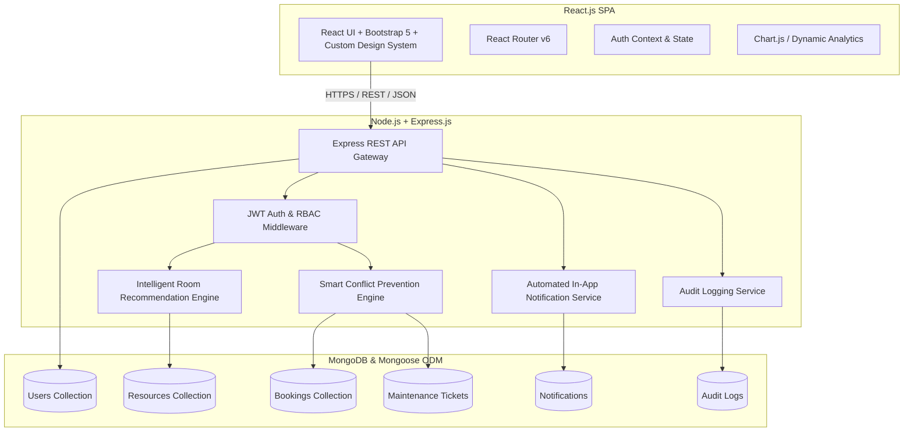

# Smart Campus and Resource Management System (SCRMS)
## System Architecture Design & Technical Specification

**Course:** Full Stack Development (Course Code: 23DC2032)  
**Evaluation:** Skill Based Evaluation (IA III) — Capstone Project  
**Target Rubric Level:** Excellent (5/5) across all criteria  

---

## 1. System Overview & Problem Statement

Colleges and university campuses manage classrooms, computing laboratories, seminar halls, high-lumen projectors, maker spaces, and sports facilities. When these operations rely on manual registers, departmental spreadsheets, or isolated communication channels, several systemic issues arise:
- **Double Bookings & Scheduling Collisions:** Lack of real-time centralized synchronization.
- **Under-Utilized Assets:** Large 200-seat auditoriums booked for 15-person meetings while high-tech labs remain idle.
- **Untracked Maintenance:** Damaged equipment (e.g., flickering projector lamps, broken Ethernet ports) is not flagged, leading to lecture cancellations.
- **Lack of Role Oversight:** Inability to differentiate student booking permissions from faculty and administrator controls.

**The Smart Campus and Resource Management System (SCRMS)** solves these challenges via a centralized three-tier web application featuring **real-time conflict detection**, **intelligent rule-based room recommendations**, **automated in-app notifications**, **equipment maintenance tracking**, and **dynamic analytics**.

---

## 2. Three-Tier Architectural Design

### Layer 1 — Presentation Layer (Client)
- **Framework:** React 18 with Vite build tool.
- **Styling:** Bootstrap 5, Bootstrap Icons, with custom HSL dark-mode glassmorphic CSS tokens (`client/src/index.css`).
- **Client Routing:** `react-router-dom` v6 with `ProtectedRoute` component enforcing RBAC guards.
- **Interactive Dashboards:** Visual timetable calendar grid, Chart.js utilization histograms, and quick 1-click evaluation demo switcher.

### Layer 2 — Application Layer (Server)
- **Runtime & Framework:** Node.js v24 + Express.js.
- **Authentication & Authorization:** Stateless JWT tokens (`jsonwebtoken`) with salted BCrypt password hashing (`bcryptjs`).
- **Middleware:** `protect` (verifies token integrity and active account status), `authorize` (strict RBAC permission checks).
- **Business Logic Services:**
  - `conflictService.js`: Rigorous overlap check with alternative time and venue generation.
  - `recommendationService.js`: Capacity fit and equipment match scoring algorithm.
  - `notificationService.js`: Automated event-driven alert generator.

### Layer 3 — Data Layer (Persistence)
- **Database:** MongoDB with Mongoose 8 ODM.
- **Seamless Local Operation:** Connects to `process.env.MONGODB_URI` (local or MongoDB Atlas) with automatic fallback to embedded in-memory MongoDB for zero-configuration testing.
- **Collections:** `users`, `resources`, `bookings`, `maintenancetickets`, `notifications`, `auditlogs`.

---

## 3. Core Algorithms & Innovation Features

### 3.1 Strict Conflict Detection Algorithm
To prevent race conditions and overlapping bookings for any given resource, the system enforces the standard mathematical interval intersection formula:

$$\text{Conflict} \iff (\text{existing.startTime} < \text{requested.endTime}) \land (\text{existing.endTime} > \text{requested.startTime})$$

- Excludes bookings in `Cancelled` or `Rejected` states.
- When an overlap occurs, the backend rejects the request with **HTTP 409 Conflict** and attaches:
  1. **Alternative Time Slots:** Evaluates open non-overlapping 2-hour windows on the same date.
  2. **Alternative Suitable Facilities:** Finds other venues matching the requested facility type and seating capacity.

### 3.2 Intelligent Rule-Based Room Recommendations
The scoring engine evaluates available facilities and assigns a match percentage score ($0 - 100\%$):

1. **Capacity Fit (40 Points Max):**
   - Ideal utilization ($\text{Capacity} / \text{Attendees} \in [1.0, 1.25]$): 40 pts.
   - Comfortable size ($\text{Ratio} \in [1.26, 1.75]$): 30 pts.
   - Large venue ($\text{Ratio} > 1.75$): 20 pts.
2. **Equipment Match (35 Points Max):**
   - Calculates the fraction of requested equipment tags (e.g. Projector, AC, Smart Board) satisfied by the facility: $\frac{\text{matched}}{\text{requested}} \times 35$.
3. **Location Proximity (15 Points Max):**
   - Matches preferred building names: 15 pts.
4. **Instant Booking Policy (10 Points Max):**
   - Fast-track facilities requiring no manual approval: 10 pts.

---

## 4. Role-Based Access Control (RBAC) Matrix

| Feature / Action | Student | Faculty | Resource Manager | Administrator |
|---|:---:|:---:|:---:|:---:|
| **Discover & View Facilities** | Yes | Yes | Yes | Yes |
| **Check Facility Availability** | Yes | Yes | Yes | Yes |
| **Submit Reservation Requests** | Yes | Yes | Yes | Yes |
| **Smart Recommendations Wizard** | Yes | Yes | Yes | Yes |
| **Cancel Own Reservations** | Yes | Yes | Yes | Yes |
| **Approve / Reject Requests** | No | Optional (if delegated) | **Yes** | **Yes** |
| **Provision & Edit Facilities** | No | No | **Yes** | **Yes** |
| **Report Maintenance Faults** | Yes | Yes | Yes | Yes |
| **Assign Technicians & Resolve** | No | No | **Yes** | **Yes** |
| **View System-wide Analytics** | No | Limited | **Yes** | **Yes** |
| **Manage Users & Role Assignment** | No | No | No | **Yes** |
| **Inspect System Audit Logs** | No | No | No | **Yes** |

*Security Note:* Permissions are strictly enforced in backend middleware (`server/middleware/role.js`). UI element masking alone is never relied upon for security.

---

## 5. Database Schema Specifications

### 5.1 Users Collection (`users`)
- `name`: String (2-100 chars, required)
- `email`: String (lowercase, unique, indexed)
- `passwordHash`: String (bcrypt hash)
- `role`: Enum (`'student'`, `'faculty'`, `'resource_manager'`, `'admin'`)
- `department`: String (e.g., Computer Science)
- `phone`: String
- `isActive`: Boolean (default `true`)
- `timestamps`: `createdAt`, `updatedAt`

### 5.2 Resources Collection (`resources`)
- `name`: String (e.g., "Turing Advanced Computing Lab (CS-301)")
- `type`: Enum (`'Classroom'`, `'Computer Lab'`, `'Seminar Hall'`, `'Projector'`, `'Lab Equipment'`, `'Sports Facility'`, `'Auditorium'`, `'Conference Room'`)
- `location`: `{ building: String, floor: String, roomNumber: String }`
- `capacity`: Number (min: 1)
- `equipment`: Array of Strings (e.g., `["High-End PCs", "4K Projector", "Air Conditioning"]`)
- `status`: Enum (`'Available'`, `'Under Maintenance'`, `'Deactivated'`)
- `approvalRequired`: Boolean (default: `true`)
- `description`: String

### 5.3 Bookings Collection (`bookings`)
- `userId`: ObjectId (ref: User)
- `resourceId`: ObjectId (ref: Resource)
- `startTime`: Date (required, indexed)
- `endTime`: Date (required, indexed, must be > startTime)
- `purpose`: String (required)
- `attendeesCount`: Number (default: 1)
- `status`: Enum (`'Pending'`, `'Approved'`, `'Rejected'`, `'Cancelled'`)
- `decisionBy`: ObjectId (ref: User)
- `decisionReason`: String
- `timestamps`: `createdAt`, `updatedAt`

### 5.4 Maintenance Tickets (`maintenancetickets`)
- `resourceId`: ObjectId (ref: Resource)
- `reportedBy`: ObjectId (ref: User)
- `description`: String (required)
- `priority`: Enum (`'Low'`, `'Medium'`, `'High'`, `'Urgent'`)
- `status`: Enum (`'Open'`, `'In Progress'`, `'Resolved'`)
- `assignedTo`: String
- `resolutionNotes`: String
- `resolvedAt`: Date

### 5.5 Notifications Collection (`notifications`)
- `userId`: ObjectId (ref: User)
- `message`: String
- `type`: Enum (`'booking_update'`, `'maintenance_update'`, `'conflict_alert'`, `'system'`)
- `isRead`: Boolean (default: `false`)
- `link`: String

### 5.6 Audit Logs Collection (`auditlogs`)
- `actorId`: ObjectId (ref: User)
- `action`: String (e.g. `'BOOKING_CREATED'`, `'BOOKING_APPROVED'`, `'RESOURCE_UPDATED'`)
- `entityType`: Enum (`'User'`, `'Resource'`, `'Booking'`, `'MaintenanceTicket'`, `'Auth'`)
- `entityId`: ObjectId
- `details`: Mixed
- `ipAddress`: String
- `createdAt`: Date
