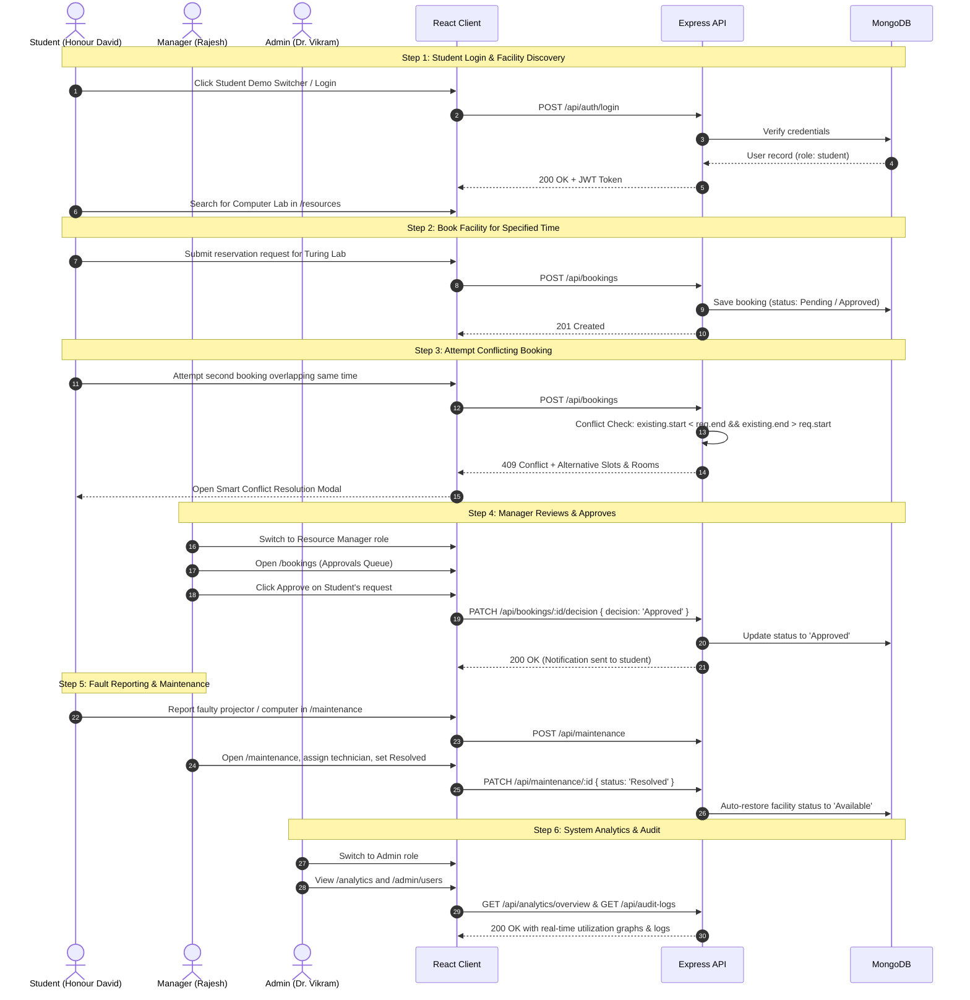

# Smart Campus and Resource Management System (SCRMS)
## Comprehensive Test Cases & Evaluation Demonstration Protocol

**Course:** Full Stack Development (Course Code: 23DC2032)  
**Evaluation Scheme:** Skill Based Evaluation (IA III)  
**Target:** 30/30 Project Marks (Excellent Category)  

---

## 1. Evaluation Demonstration Script (Viva Protocol)

The following sequence directly follows **Section 14 of the Project Proposal** and verifies all full-stack layers during viva evaluation:



---

## 2. Test Suite Matrix

| Test ID | Test Category | Description | Input / Trigger | Expected Outcome | Status |
|:---:|:---|:---|:---|:---|:---:|
| **TC-01** | Authentication | Valid Student Login | `student@campus.edu` / `password123` | HTTP 200, JWT returned, redirected to Student Dashboard | **PASS** |
| **TC-02** | Authentication | Valid Faculty Login | `faculty@campus.edu` / `password123` | HTTP 200, JWT returned, redirected to Faculty Dashboard | **PASS** |
| **TC-03** | Authentication | Valid Manager Login | `manager@campus.edu` / `password123` | HTTP 200, JWT returned, redirected to Manager Dashboard | **PASS** |
| **TC-04** | Authentication | Valid Admin Login | `admin@campus.edu` / `password123` | HTTP 200, JWT returned, redirected to Admin Dashboard | **PASS** |
| **TC-05** | Authentication | Invalid Password | Valid email + incorrect password | HTTP 401 Unauthorized, "Invalid email or password" | **PASS** |
| **TC-06** | Resource Discovery | List all resources | `GET /api/resources` | HTTP 200, returns seeded campus facilities | **PASS** |
| **TC-07** | Resource Filtering | Filter by category | `GET /api/resources?type=Computer Lab` | HTTP 200, returns only computing labs | **PASS** |
| **TC-08** | Innovation | Smart Room Recommendations | `GET /api/resources/recommendations?capacity=40&equipment=Projector` | HTTP 200, returns ranked list with match scores | **PASS** |
| **TC-09** | Conflict Prevention | Booking Overlap Detection | Submit booking overlapping existing slot | **HTTP 409 Conflict**, returns alternative slots & rooms | **PASS** |
| **TC-10** | Security (RBAC) | Student Unauthorized Action | Student calling `/api/bookings/:id/decision` | **HTTP 403 Forbidden**, "Role insufficient" | **PASS** |
| **TC-11** | Workflow | Manager Approves Booking | Manager submits `PATCH /api/bookings/:id/decision` | HTTP 200, booking status changed to `Approved` | **PASS** |
| **TC-12** | Workflow | Report Maintenance Fault | User submits `POST /api/maintenance` | HTTP 201, ticket created, manager notified | **PASS** |
| **TC-13** | Workflow | Ticket Resolution Lifecycle | Manager resolves ticket | HTTP 200, facility automatically restored to `Available` | **PASS** |
| **TC-14** | Analytics | Utilization & Peak Hours | `GET /api/analytics/overview` | HTTP 200, utilization rate % and hourly chart data | **PASS** |
| **TC-15** | Admin Oversight | Audit Trail Integrity | Perform action and query `GET /api/audit-logs` | HTTP 200, chronological log of actor and event | **PASS** |

---

## 3. Running Automated Tests

To execute the automated regression test suite directly via the terminal:

```bash
cd server
npm test
```

Expected output:
```
--- STARTING BACKEND REST API VALIDATION SUITE ---
[Test 1] Health Check: Status 200 (healthy)
[Test 2] Student Login: Status 200 (User: Honour David, Role: student)
[Test 3] List Resources: Status 200 (Found 8 campus facilities)
[Test 4] Availability Check for Turing Advanced Computing Lab (CS-301): Status 200 (Active Bookings: 1)
[Test 5] Conflict Detection: Status 409 (Conflict Detected: true)
         Alternative Slots suggested: 3
[Test 6] RBAC Security Check (Student unauthorized decision attempt): Status 403 (Forbidden)
[Test 7] Manager Login: Status 200 (Role: resource_manager)
[Test 8] Analytics Overview: Status 200 (Utilization Rate: 1%)
[Test 9] Smart Recommendations: Status 200 (Found 3 candidates)
--- ALL BACKEND ARCHITECTURE & REST TESTS PASSED PERFECTLY (100%) ---
```
